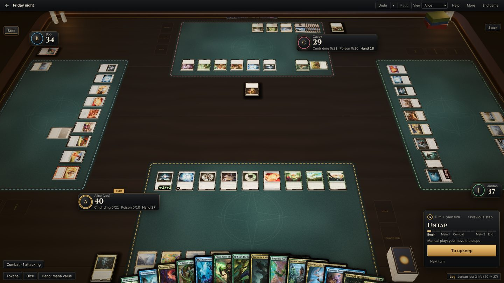
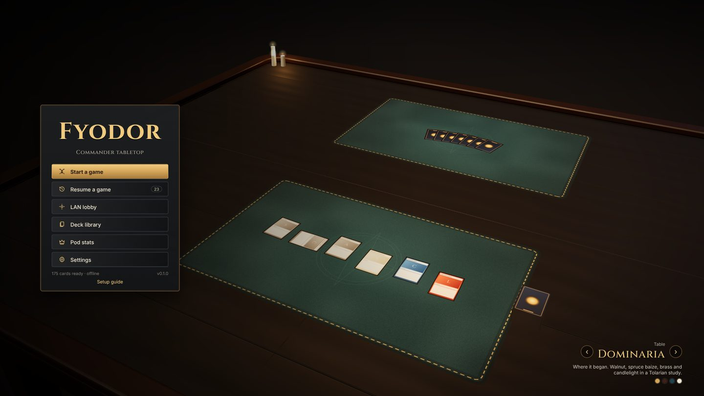
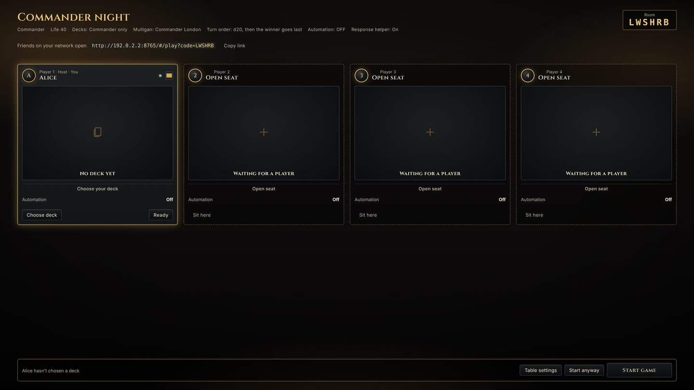
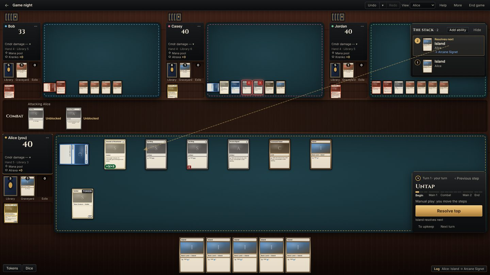
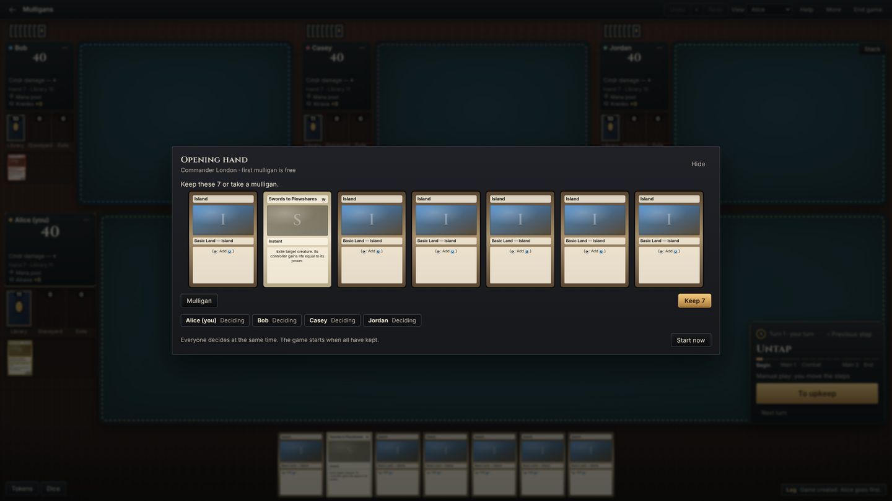

# Fyodor — offline Commander tabletop

A private, offline-first digital tabletop for one **Magic: The Gathering Commander** pod: each
player on their own computer, joined over the LAN to one host. Once the card data is downloaded,
nothing needs the Internet.



- **A physical table.** A three.js 3D table, or a lighter 2D table, where anything can be moved
  by hand, as in Tabletop Simulator.
- **A rules engine.** Deterministic automation researched from the Comprehensive Rules, set per
  table: *Off* (sandbox), *Assisted* or *Full*. Supported cards play themselves. Everything else
  falls back to the manual table, so nothing ever blocks the game. Coverage is reported per card
  in [`docs/RULES_COVERAGE.md`](docs/RULES_COVERAGE.md).
- **Clear priority.** A turn and priority dial, the stack as a chain on the table, and a
  response helper that only stops you when you can act.

- **Tabletop**: free card positioning, drag and drop between every zone, tap/untap, counters,
  tokens, copies, face-down cards, transform/MDFC/adventure/split faces, notes, reveal,
  library search / look at top N / mill, the stack, combat markers, dice and coins
- **Commander**: command zone with automatic (adjustable) commander tax, commander damage
  per commander with 21-damage warnings, poison, energy, experience, custom counters,
  monarch, initiative, city's blessing, day/night
- **History**: every action is logged; unlimited-style undo/redo (default 500 steps),
  save/load with full history, autosave
- **Multiplayer**: hot-seat on one computer, or LAN play where the host is authoritative
  and each device only receives what its player is allowed to see
- **Decks**: paste lists from Moxfield, Archidekt, MTGGoldfish, Arena or plain text;
  deck library, editor, printing picker, advisory checks

| | |
|---|---|
|  |  |
|  |  |

See [`docs/IMPLEMENTATION_PLAN.md`](docs/IMPLEMENTATION_PLAN.md) and
[`docs/ARCHITECTURE.md`](docs/ARCHITECTURE.md) for design details.

## Download (no Python or Node needed)

Grab the zip for your computer from the repository's **Releases** page (or the latest
**Downloadable app** run in the Actions tab), unzip it and double-click **Fyodor**
(`Fyodor.exe` on Windows). The first start downloads the card database once (~80 MB); after
that it runs with no Internet. When new sets come out, the host opens **Settings → Card
database → Check for new cards** while online. Cards and saves live in a `Fyodor` folder in
your home folder, so a newer download keeps them.

- **Windows** may show "Windows protected your PC": click *More info* → *Run anyway*, and allow
  it on private networks when the firewall asks (that's what lets the pod join).
- **macOS**: the app isn't signed, so right-click **Fyodor** → *Open* the first time.

To build it yourself: `scripts/build-app.sh` (on Windows, from Git Bash) → `dist/Fyodor/`.
A new tag like `v0.2.0` builds all three and attaches them to a release.

## Requirements (running from source)

- Python 3.11+
- Node.js 20+ (only needed to build/run the frontend)
- ~300 MB disk for card data, plus images (a few hundred MB for your decks' cards,
  ~2.5 GB for one image of every card)

## Setup

```bash
scripts/setup.sh                    # backend venv + npm install
scripts/update-cards.sh             # download Scryfall card data (needs Internet once, ~80 MB)
scripts/update-cards.sh --skip-data --images tokens   # optional: token art (~100 MB)
```

To prepare a deck library before going offline, open **Decks → Import multiple decks** on the
Fyodor host. Select multiple exported deck files, or paste public Archidekt deck URLs one per line
while network access is enabled. Preview the lists, then choose **Save decks**. Leave artwork
downloading enabled and keep the window open until the batch finishes. Each deck is saved
individually; an invalid file does not prevent the other decks from being imported. Unresolved
cards and incomplete artwork are shown for review.

Saved decks and cached images live in the host's data directory and survive app restarts.
Players can connect to that host over the local network without internet. They are not stored
in each visiting browser; use the existing backup/package tools to move them to another host.
Missing images can be retried from the deck editor's artwork controls.

After importing decks you can cache their art with `scripts/update-cards.sh --skip-data --images decks`.
Image downloads resume where they stopped and never download a file twice. Cards without a
cached image are drawn as readable text cards, so the game is fully playable without any
images.

`update-cards.sh` wraps `python -m tools.update_cards` (run from `backend/`). Options:

| Option | Meaning |
|---|---|
| `--bulk default_cards` | Scryfall dataset: `default_cards` (all English printings, default), `oracle_cards`, `all_cards`, `unique_artwork` |
| `--images none\|decks\|tokens\|default\|all` | which images to cache (default `none`) |
| `--size normal` | image size: `small`, `normal`, `large`, `art_crop` |
| `--file PATH` | import a bulk file you already have (no network) |
| `--force` | re-import even if the local data is current |
| `--skip-data` | only download images |

## Running

**Game night** (one command; sets up on first run, checks the card database, data folder and
port, prints the address for the pod and opens your browser):

```bash
Start Fyodor.bat          # Windows: double-click (installs and downloads cards on the first run)
Start Fyodor.command      # macOS: double-click
scripts/start.sh          # Linux / terminal; add --local for this computer only
```

The first time you open it, a short **setup guide** on the home page asks your name, confirms
the card database and shows how others join. You can reopen it from the home page.

**Development** (hot reload, two servers):

```bash
scripts/dev.sh      # backend http://127.0.0.1:8000, frontend http://127.0.0.1:5173
```

**Normal use** (one server, built frontend):

```bash
scripts/serve.sh    # builds the frontend, serves everything on http://127.0.0.1:8000
```

### LAN play

```bash
scripts/start.sh                    # or: FYODOR_HOST=0.0.0.0 scripts/serve.sh
```

1. On the host, open `http://127.0.0.1:8000` → **Play** → choose *LAN* → **Start game**.
   The top bar shows a room code (the Play page lists the host's LAN addresses).
2. Other devices open `http://HOST-IP:8000` → **Play** → *Join a LAN game* with the code
   (and password, if set). Players get a free seat; extra people can spectate.
3. Reloading or reconnecting reclaims your seat automatically (the seat token is stored in
   the browser).

Hot-seat (local) games and the saves/game management endpoints only accept requests from
the host computer itself.

## Playing

- **Drag** cards anywhere: battlefield, hand, piles, the stack, another player's
  battlefield (gives control). Drag on empty table to box-select.
- **Double-click**: tap/untap (battlefield), play (hand), draw (library), cast (command zone).
- **Right-click** anything for the full action list (counters, copies, face down, attack,
  block, move to library position N, reveal, give control, notes…).
- Click your **library** for draw N, shuffle, search, look at top N, reveal, mill, mulligan.
- Keys: `D` draw · `T`/space tap · `F` turn over · `N` next step · `Shift+N` next turn ·
  `U` untap all · `Delete` to graveyard · `Ctrl+Z` / `Ctrl+Shift+Z` undo/redo · `G` ping ·
  `S` sort your hand · `?` help.
- **Ping** (`G`, or Alt+click) shows everyone a ring and your name on a card or spot, as in
  Tabletop Simulator. When the table waits on you while the tab is in the background, the tab
  title flashes and a chime plays (Settings can turn both off).
- In hot-seat games use **View** in the top bar to switch seats, or *Open table* to see
  every hand (goldfishing).

## Configuration

Environment variables (or a `.env` file in `backend/`), see [`.env.example`](.env.example):

| Variable | Default | |
|---|---|---|
| `FYODOR_DATA_DIR` | `./data` | card DB, images, decks and saves |
| `FYODOR_HOST` / `FYODOR_PORT` | `127.0.0.1` / `8000` | bind address (used by the scripts) |
| `FYODOR_LOG_LEVEL` | `INFO` | |
| `FYODOR_AUTOSAVE_EVERY` | `10` | autosave after this many actions |
| `FYODOR_HISTORY_LIMIT` | `500` | undo steps kept per game |
| `FYODOR_ALLOW_NETWORK` | `1` | `0` turns off Archidekt import, artwork caching and card updates |
| `FYODOR_AUTO_BACKUP_MINUTES` | `30` | automatic backups while anything changes; `0` turns them off |
| `FYODOR_BACKUP_COPY_DIR` | unset | also copy every backup here (a USB stick or synced folder) |
| `FYODOR_CORS_ORIGINS` | dev server | comma-separated |
| `FYODOR_ASSISTANT_URL` | unset | Ollama-compatible endpoint for the optional rules assistant |
| `FYODOR_ASSISTANT_MODEL` | `llama3.1` | |

Data layout:

```
data/
  cards.sqlite        # rebuilt by update-cards (safe to delete)
  app.sqlite          # your decks and saved games
  images/cards/<id[:2]>/<scryfall-id>-<face>-<size>.jpg
  images/tokens/…
  downloads/          # cached bulk file
```

## Tests

```bash
scripts/test.sh     # ruff + pytest (backend), tsc + vitest (frontend)
```

The backend suite covers card import and search, deck parsing, every game action,
undo/redo restoring exact state (including library order after shuffles), save/load
across restarts, and hidden-information leaks for every viewer over REST and WebSocket.
A manual smoke test is in [`docs/SMOKE_TEST.md`](docs/SMOKE_TEST.md).

Browser end-to-end tests (Playwright, against the production build and a fixture card
database; no Internet):

```bash
E2E=1 scripts/test.sh                        # everything, including the browser tests
(cd frontend && npm run build && npx playwright test e2e/pod-night.spec.ts)   # one spec
```

`e2e/pod-night.spec.ts` is the full pod regression. Four devices go through the lobby, decks,
mulligans, plays, life and commander damage, a dropped device, a snapshot restore and hidden-hand
checks on every device's network traffic, and end with the result in pod stats. The other specs
each cover one area: LAN lobby, mulligans, the response helper, reconnects, table tools, assets,
snapshots, macros/solo, packages/diagnostics and the first-run guide. CI runs all of them.

## Project layout

```
backend/
  app/api/          REST + WebSocket routes
  app/cards/        card DB schema, Scryfall importer, search, image cache, downloader
  app/decks/        decklist parser, deck repository, advisory validation
  app/game/         pure game engine: state, actions, resolve, engine, views, history
  app/multiplayer/  rooms, seats, connections
  app/storage/      SQLite helpers, migrations, versioned saves
  app/rules/        the rules engine: priority, the stack, combat, triggers and card automation
  app/assistant/    optional local AI rules assistant (disabled by default)
  tools/update_cards.py
  tests/
frontend/src/
  pages/            home, card browser, decks, deck editor, lobby, game
  game/             table UI (battlefield, hand, piles, panels, menus, drag and drop)
  cards/            card rendering (images with text fallback)
  state/            zustand stores (game, card cache), view reconciliation
  services/         REST + WebSocket clients
docs/               plan, architecture, deck format, smoke test, security
scripts/            start (launcher), setup, dev, serve, test, update-cards
```

## Privacy

No telemetry, analytics or tracking. Fyodor only goes online when you ask it to: the card and
image download in `update-cards` or Settings → Card database, importing a deck from an
Archidekt link, caching a deck's artwork, and the optional assistant endpoint you configure
yourself. Set `FYODOR_ALLOW_NETWORK=0`
to turn off Archidekt import, artwork caching and card updates.

Card data and images are provided by [Scryfall](https://scryfall.com). Magic: The Gathering
is © Wizards of the Coast. Fyodor is unofficial Fan Content and not affiliated with them.

### Personal collections for LAN players

In the lobby, use **Bring a deck → My decks** to save multiple deck files or public Archidekt
URLs while online. Saved lists work without Internet at that table. **Export My decks** makes
a backup you can import at another table address or on another device. Your imported decks
automatically supply your private collection, including companion candidates; they do not
expose another player's decks or the host's library. Commander still prohibits ordinary Wish
and Learn imports (CR 903.11). See [personal collections](docs/PLAYER_COLLECTIONS_AND_OUTSIDE_GAME.md).
